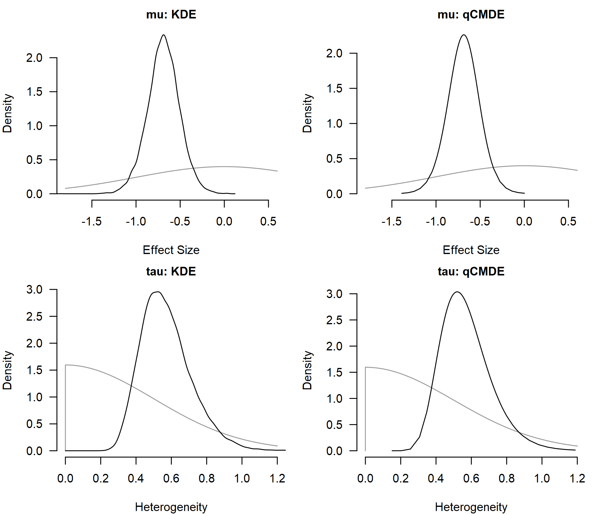
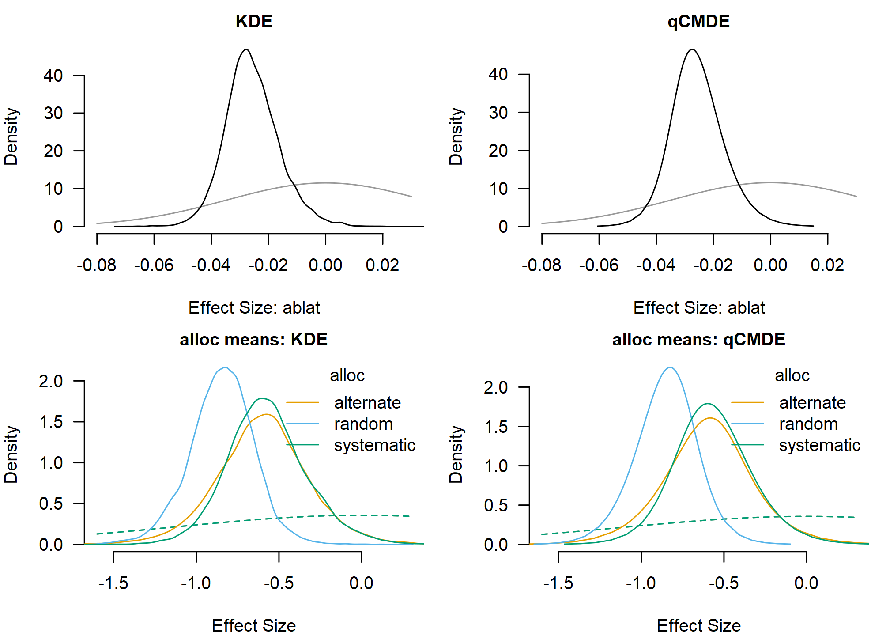

# Posterior Densities and Parameter Tests

Bayesian meta-analysis produces posterior distributions for the average
effect, the between-study heterogeneity, and any meta-regression
coefficients. Evidence for or against specific values of these
parameters can be quantified via Bayes factors.

The posterior distributions are usually summarized via posterior means
and credible intervals, and visualized via (prior and) posterior density
plots, usually obtained via kernel density estimation (KDE). The KDE
visualization can be, however, quite “bumpy” even with a sizable number
of posterior samples. In the first part of this vignette we illustrate
how the posterior density visualization can be improved via q-grid
conditional marginal density estimator (qCMDE) implemented in the
`RoBMA` R package ([Bartoš & Maier, 2020](#ref-RoBMA)).

In the second part of the vignette, we illustrate how to compute Bayes
factors based on posterior distribution in the `RoBMA` R package (which
takes advantage of the qCMDE estimator when testing a point null
hypothesis). This posterior samples route allows us to re-use a single
model fit with a Savage–Dickey density ratio ([Dickey,
1971](#ref-dickey1971weighted); [Wagenmakers et al.,
2010](#ref-wagenmakers2010bayesian)) to compute Bayes factor for
point-null hypotheses and encompassing-prior odds ([Klugkist et al.,
2005](#ref-klugkist2005bayesian)) for inequality and region hypotheses.
It adds to the existing bridge sampling route ([Gronau et al.,
2017](#ref-gronau2017tutorial)) which compares marginal likelihoods of
separately fitted constrained and unconstrained models (see “Comparing
Models with Bayes Factors” in [*Bayesian
Meta-Analysis*](https://fbartos.github.io/RoBMA/articles/v02-bayesian-meta-analysis.md)),
and the product-space route ([Lodewyckx et al.,
2011](#ref-lodewyckx2011tutorial)) which fits multiple models
simultaneously in a single MCMC run and estimates the Bayes factor from
the posterior inclusion probabilities (see [*Bayesian Model
Averaging*](https://fbartos.github.io/RoBMA/articles/v20-bayesian-model-averaging.md)).

We use the BCG vaccine dataset from the `metafor` package ([Viechtbauer,
2010](#ref-metafor)) to walk through the density estimation and Bayes
factor computation. We start with a simple random-effects meta-analysis,
compare KDE and qCMDE on the average effect and heterogeneity, and use
[`hypothesis()`](https://fbartos.github.io/RoBMA/reference/hypothesis.md)
to test three hypotheses on the average effect with results matched
against bridge sampling. We then add a continuous and a categorical
moderator and combine
[`marginal_means()`](https://fbartos.github.io/RoBMA/reference/marginal_means.md)
with
[`hypothesis()`](https://fbartos.github.io/RoBMA/reference/hypothesis.md)
for tests on estimated marginal means. All effect sizes are on the log
risk-ratio scale, so the no-effect value is 0.

## Simple Meta-Analysis

The BCG vaccine dataset contains 13 randomized trials on tuberculosis
prevention. `escalc()` computes log risk ratios `yi` and their sampling
variances `vi`.

``` r

data("dat.bcg", package = "metadat")

dat <- metafor::escalc(
  ai = tpos, bi = tneg, ci = cpos, di = cneg,
  measure = "RR", data = dat.bcg
)
```

We first fit a random-effects meta-analysis with a standard normal prior
distribution on the mean effect.

``` r

prior_effect_normal <- prior(distribution = "normal", parameters = list(mean = 0, sd = 1))

fit_simple <- brma(
  yi = yi, vi = vi, measure = "RR",
  prior_effect = prior_effect_normal,
  data = dat, seed = 1
)
```

``` r

summary(fit_simple)
#> 
#> Bayesian Random-Effects Model (k = 13)
#> 
#> Estimates
#>       Mean    SD  0.025    0.5  0.975 error(MCMC) error(MCMC)/SD   ESS R-hat
#> mu  -0.689 0.182 -1.057 -0.688 -0.330     0.00149          0.008 15000 1.000
#> tau  0.572 0.143  0.342  0.554  0.897     0.00176          0.012  6688 1.000
```

## qCMDE Posterior Density Estimation

By default,
[`plot.brma()`](https://fbartos.github.io/RoBMA/reference/plot.brma.md)
visualizes marginal posterior distributions with kernel density
estimation (KDE) on the sampled MCMC draws. KDE summaries are convenient
and generic, but they might not look smooth even with a sizable number
of posterior samples, and the density value at a specific point, for
example `mu = 0`, inherits the same Monte Carlo noise.

qCMDE is a model-aware alternative that leverages information in the
joint posterior distribution. It provides a smoother density curve and a
more stable estimate of the marginal posterior density at any
user-specified value. The construction extends the Rao–Blackwellized
marginal density estimator of Gelfand et al.
([1992](#ref-gelfand1992bayesian)) and the importance-weighted marginal
density estimator of Chen ([1994](#ref-chen1994importance)).

Passing `density_method = "qCMDE"` to
[`plot.brma()`](https://fbartos.github.io/RoBMA/reference/plot.brma.md)
switches the density route from the default KDE to qCMDE. We compare the
two estimators (KDE in black, qCMDE in blue) for the average effect
(`mu`) and the between-study heterogeneity (`tau`); the grey curves
overlay the corresponding prior distribution.

``` r

par(mfrow = c(2, 2), mar = c(4, 4, 2, 1), cex.axis = 0.8, cex.lab = 0.8, cex.main = 0.75)

plot(fit_simple, parameter = "mu",  prior = TRUE, density_method = "KDE",   main = "mu: KDE",   xlim = c(-1.8, 0.6))
plot(fit_simple, parameter = "mu",  prior = TRUE, density_method = "qCMDE", density_control = list(samples = 1000L), main = "mu: qCMDE", xlim = c(-1.8, 0.6))
plot(fit_simple, parameter = "tau", prior = TRUE, density_method = "KDE",   main = "tau: KDE",   xlim = c(0, 1.2))
plot(fit_simple, parameter = "tau", prior = TRUE, density_method = "qCMDE", density_control = list(samples = 1000L), main = "tau: qCMDE", xlim = c(0, 1.2))
```



The qCMDE curves are smoother on both panels, but otherwise track the
KDE summary in shape and location.

## Testing the Mean Effect

Bayes factors compare two models by their prior predictive performance,
usually through the ratio of marginal likelihoods ([Kass & Raftery,
1995](#ref-kass1995bayes)). For point-null hypotheses on a single
parameter, the same Bayes factor can be obtained from the Savage–Dickey
density ratio ([Dickey, 1971](#ref-dickey1971weighted); [Wagenmakers et
al., 2010](#ref-wagenmakers2010bayesian)), which needs only the prior
and posterior density ordinate at the tested value. For inequality and
region hypotheses, the encompassing-prior approach computes the Bayes
factor as the change from prior odds to posterior odds for the
restricted region ([Klugkist et al., 2005](#ref-klugkist2005bayesian)).
The Savage–Dickey and encompassing-prior routes are both available from
a single fit through
[`hypothesis()`](https://fbartos.github.io/RoBMA/reference/hypothesis.md);
the rest of this section walks through three example hypotheses on the
average effect and contrasts both routes:

- $`\text{BF}_{10}`$: an unrestricted average effect against a point
  null at 0;
- $`\text{BF}_{-0}`$: a negative average effect against a point null at
  0;
- $`\text{BF}_{-+}`$: a negative average effect against a positive
  average effect.

The posterior-based route uses
[`hypothesis()`](https://fbartos.github.io/RoBMA/reference/hypothesis.md).
With `density_method = "qCMDE"`, the point-null hypotheses use the qCMDE
ordinate at 0 which improves stability of the estimate. The region test
$`\text{BF}_{-+}`$ uses prior-posterior odds and does not need a density
ordinate.

``` r

mu_posterior_bf <- hypothesis(
  fit_simple, density_method = "qCMDE",
  hypothesis     = c(
    "mu != 0",
    "mu < 0 vs mu = 0",
    "mu < 0 vs mu > 0"
  ),
)
mu_posterior_bf
#>  Alternative:  Null:       BF error%(BF)
#>       mu != 0 mu = 0   58.328     10.580
#>        mu < 0 mu = 0  116.610     10.580
#>        mu < 0 mu > 0 2499.000     40.834
#> qCMDE relative MCSE is 10.6% (requested precision target 5%). Higher precision can be obtained by increasing 'samples' in the 'density_control' argument.
#> qCMDE relative MCSE is 10.6% (requested precision target 5%). Higher precision can be obtained by increasing 'samples' in the 'density_control' argument.
#> qCMDE finite-population row-sampling relative error is 10.8% (requested precision target 5%). Higher precision can be obtained by increasing 'samples' in the 'density_control' argument.
#> qCMDE finite-population row-sampling relative error is 10.8% (requested precision target 5%). Higher precision can be obtained by increasing 'samples' in the 'density_control' argument.
#> qCMDE effective sample size is 70.7 (warning threshold 100).
#> qCMDE effective sample size is 70.7 (warning threshold 100).
```

The bridge sampling route fits one constrained model per hypothesis
side, attaches marginal likelihoods with
[`add_marglik()`](https://fbartos.github.io/RoBMA/reference/add_marglik.brma.md),
and compares them with
[`bf()`](https://rdrr.io/pkg/bridgesampling/man/bf.html).

``` r

prior_effect_null     <- prior(distribution = "spike",  parameters = list(location = 0))
prior_effect_negative <- prior(distribution = "normal", parameters = list(mean = 0, sd = 1), truncation = list(lower = -Inf, upper = 0))
prior_effect_positive <- prior(distribution = "normal", parameters = list(mean = 0, sd = 1), truncation = list(lower = 0, upper = Inf))

fit_simple <- add_marglik(fit_simple)

fit_simple_mu_null <- brma(
  yi = yi, vi = vi, measure = "RR",
  prior_effect = prior_effect_null,
  data = dat, seed = 2
)
fit_simple_mu_null <- add_marglik(fit_simple_mu_null)

fit_simple_mu_negative <- brma(
  yi = yi, vi = vi, measure = "RR",
  prior_effect = prior_effect_negative,
  data = dat, seed = 3
)
fit_simple_mu_negative <- add_marglik(fit_simple_mu_negative)

fit_simple_mu_positive <- brma(
  yi = yi, vi = vi, measure = "RR",
  prior_effect = prior_effect_positive,
  data = dat, seed = 4
)
fit_simple_mu_positive <- add_marglik(fit_simple_mu_positive)
```

``` r

bf_10         <- bf(fit_simple, fit_simple_mu_null)
bf_minus_0    <- bf(fit_simple_mu_negative, fit_simple_mu_null)
bf_minus_plus <- bf(fit_simple_mu_negative, fit_simple_mu_positive)
```

The two routes answer the same questions through different computations.
Bridge sampling compares separately fitted constrained models, while the
posterior-based route reuses one fitted model and only needs the qCMDE
ordinate at the tested value. The table reports the resulting Bayes
factors and the corresponding error estimates in percentages.

| Test               | Posterior BF | Bridge BF |
|:-------------------|-------------:|----------:|
| $`\text{BF}_{10}`$ |         58.3 |      65.6 |
| $`\text{BF}_{-0}`$ |        116.6 |     130.9 |
| $`\text{BF}_{-+}`$ |       2499.0 |    2027.8 |

Bayes factor estimates for the mean-effect hypotheses. {.table}

The point-null Bayes factors agree closely across the two routes. The
posterior-based value for $`\text{BF}_{-+}`$ is limited by the number of
posterior draws as only a very small proportion of samples is at the
positive side. Consequently, the encompassing prior estimate is much
more variable than the corresponding bridge sampling approach (see the
the large `error%(BF)` reported earlier). In general, Bayes factors
larger than 100 (lower than 1/100) are likely to have limited precision
when using the posterior based or product-space approaches. (This
usually does not matter for the interpretation, i.e., the data provide
overwhelming evidence for one of the hypotheses.)

## Meta-Regression

We next add absolute latitude (`ablat`) and allocation method (`alloc`)
as moderators. For the categorical moderator we use mean-difference
contrasts via `set_contrast_factor_predictors = "meandif"`. It specifies
the prior distribution such that the allocation levels are treated as
exchangeable; the prior distribution does not depend on an arbitrary
reference level and is better suited to hypothesis tests comparing
allocation methods among each other.

``` r

fit_meta_reg <- brma(
  yi = yi, vi = vi, measure = "RR",
  mods = ~ ablat + alloc,
  set_contrast_factor_predictors = "meandif",
  prior_effect = prior_effect_normal,
  data = dat, seed = 5
)
```

``` r

summary(fit_meta_reg)
#> 
#> Bayesian Mixed-Effect Model (k = 13)
#> 
#> Common Estimates
#>      Mean    SD 0.025   0.5 0.975 error(MCMC) error(MCMC)/SD  ESS R-hat
#> tau 0.382 0.155 0.124 0.366 0.725     0.00249          0.016 3889 1.000
#> 
#> Meta-Regression
#>                          Mean    SD  0.025    0.5  0.975 error(MCMC) error(MCMC)/SD   ESS R-hat
#> intercept               0.188 0.333 -0.523  0.206  0.811     0.00296          0.009 12876 1.000
#> ablat                  -0.026 0.009 -0.043 -0.026 -0.005     0.00009          0.010 11011 1.000
#> alloc[dif: alternate]   0.073 0.205 -0.346  0.075  0.490     0.00186          0.009 12313 1.000
#> alloc[dif: random]     -0.174 0.174 -0.538 -0.166  0.152     0.00165          0.009 11253 1.000
#> alloc[dif: systematic]  0.101 0.192 -0.258  0.092  0.505     0.00166          0.009 13319 1.000
```

qCMDE is again available directly through
[`plot.brma()`](https://fbartos.github.io/RoBMA/reference/plot.brma.md).
When interpreting categorical moderators, estimated marginal means
(EMMs) are a clearer way to report the results. The
[`marginal_means()`](https://fbartos.github.io/RoBMA/reference/marginal_means.md)
allows us to compute Bayes factors using `bf = TRUE` and use the qCMDE
via `density_method = "qCMDE"` arguments. The density estimate is
directly saved in the EMMs object, so the corresponding hypotheses can
be tested later with
[`hypothesis()`](https://fbartos.github.io/RoBMA/reference/hypothesis.md).

``` r

emm_meta_reg_default <- marginal_means(fit_meta_reg)
emm_meta_reg_qcmde   <- marginal_means(fit_meta_reg, bf = TRUE, density_method = "qCMDE")
```

The four panels below compare KDE and qCMDE for the `ablat` coefficient
and for the per-level posterior of the three `alloc` marginal means.

``` r

par(mfrow = c(2, 2), mar = c(4, 4, 2, 1), cex.axis = 0.8, cex.lab = 0.8, cex.main = 0.75)

plot(fit_meta_reg, parameter = "ablat", prior = TRUE, density_method = "KDE",   main = "KDE",   xlim = c(-0.08, 0.03))
plot(fit_meta_reg, parameter = "ablat", prior = TRUE, density_method = "qCMDE", main = "qCMDE", xlim = c(-0.08, 0.03))
plot(emm_meta_reg_default, parameter = "alloc", prior = TRUE, main = "alloc means: KDE",   xlim = c(-1.6, 0.3))
plot(emm_meta_reg_qcmde,   parameter = "alloc", prior = TRUE, main = "alloc means: qCMDE", xlim = c(-1.6, 0.3))
```



Hypotheses on the categorical moderator can then be stated directly in
terms of named allocation-method marginal means. The bracket syntax
(`alloc[alternate]`) selects a named level from the allocation marginal
posterior.

``` r

hypothesis(
  emm_meta_reg_qcmde,
  hypothesis = c(
    "alloc[alternate] > alloc[random]",
    "alloc[alternate] > alloc[systematic]",
    "alloc[random] > alloc[systematic]"
  )
)
#>                                            Alternative:                                       Null:    BF error%(BF)
#> mu_alloc (1)     mu_alloc[alternate] > mu_alloc[random]     mu_alloc[alternate] <= mu_alloc[random] 3.808      2.012
#> mu_alloc (2) mu_alloc[alternate] > mu_alloc[systematic] mu_alloc[alternate] <= mu_alloc[systematic] 0.921      1.634
#> mu_alloc (3)    mu_alloc[random] > mu_alloc[systematic]    mu_alloc[random] <= mu_alloc[systematic] 0.212      2.148
```

## References

Bartoš, F., & Maier, M. (2020). *RoBMA: An R package for robust Bayesian
meta-analyses*. <https://CRAN.R-project.org/package=RoBMA>

Chen, M.-H. (1994). Importance-weighted marginal bayesian posterior
density estimation. *Journal of the American Statistical Association*,
*89*(427), 818–824. <https://doi.org/10.1080/01621459.1994.10476815>

Dickey, J. M. (1971). The weighted likelihood ratio, linear hypotheses
on normal location parameters. *The Annals of Mathematical Statistics*,
204–223. <https://doi.org/10.1214/aoms/1177693507>

Gelfand, A. E., Smith, A. F., & Lee, T.-M. (1992). Bayesian analysis of
constrained parameter and truncated data problems using gibbs sampling.
*Journal of the American Statistical Association*, *87*(418), 523–532.
<https://doi.org/10.1080/01621459.1992.10475235>

Gronau, Q. F., Sarafoglou, A., Matzke, D., Ly, A., Boehm, U., Marsman,
M., Leslie, D. S., Forster, J. J., Wagenmakers, E.-J., & Steingroever,
H. (2017). A tutorial on bridge sampling. *Journal of Mathematical
Psychology*, *81*, 80–97. <https://doi.org/10.1016/j.jmp.2017.09.005>

Kass, R. E., & Raftery, A. E. (1995). Bayes factors. *Journal of the
American Statistical Association*, *90*(430), 773–795.
<https://doi.org/10.1080/01621459.1995.10476572>

Klugkist, I., Kato, B., & Hoijtink, H. (2005). Bayesian model selection
using encompassing priors. *Statistica Neerlandica*, *59*(1), 57–69.
<https://doi.org/10.1111/j.1467-9574.2005.00279.x>

Lodewyckx, T., Kim, W., Lee, M. D., Tuerlinckx, F., Kuppens, P., &
Wagenmakers, E.-J. (2011). A tutorial on Bayes factor estimation with
the product space method. *Journal of Mathematical Psychology*, *55*(5),
331–347. <https://doi.org/10.1016/j.jmp.2011.06.001>

Viechtbauer, W. (2010). Conducting meta-analyses in R with the metafor
package. *Journal of Statistical Software*, *36*(3), 1–48.
<https://doi.org/10.18637/jss.v036.i03>

Wagenmakers, E.-J., Lodewyckx, T., Kuriyal, H., & Grasman, R. (2010).
Bayesian hypothesis testing for psychologists: A tutorial on the
savage–dickey method. *Cognitive Psychology*, *60*(3), 158–189.
<https://doi.org/10.1016/j.cogpsych.2009.12.001>
